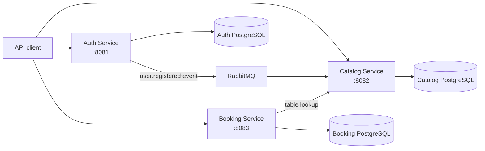

# Restaurant Booking

A microservice backend for discovering restaurants, exploring menus, and booking tables.

## About

Restaurant Booking is a REST API platform that covers the core backend workflows of a restaurant reservation service: user authentication, restaurant catalog management, reviews, table availability, and bookings.

The system is split into three Go microservices. Each service owns its PostgreSQL database, while RabbitMQ and internal HTTP requests provide asynchronous and synchronous communication between services.

## Architecture



| Service | Responsibility |
| --- | --- |
| Auth | Registration, login, user profile, and JWT issuance |
| Catalog | Restaurants, menus, tables, reviews, and cached user data |
| Booking | Table availability and reservation management |

## Tech Stack

- **Go 1.25** and **Chi** for HTTP services
- **PostgreSQL** with **pgx** for data storage
- **RabbitMQ** for user-registration events
- **JWT** for authentication and authorization
- **OpenAPI** and **Swagger UI** for API documentation
- **Docker** and **Docker Compose** for local infrastructure
- **golang-migrate** for database migrations
- **Make** for common development workflows

## Prerequisites

- Go 1.25 or later
- Docker
- Docker Compose
- Make

## Setup

1. Create the local environment file:

   ```bash
   cp .env.example .env
   ```

2. Build and start the development stack:

   ```bash
   make up
   ```

3. Explore the APIs in Swagger UI:

   - [Auth Service](http://localhost:8081/swagger/index.html)
   - [Catalog Service](http://localhost:8082/swagger/index.html)
   - [Booking Service](http://localhost:8083/swagger/index.html)
